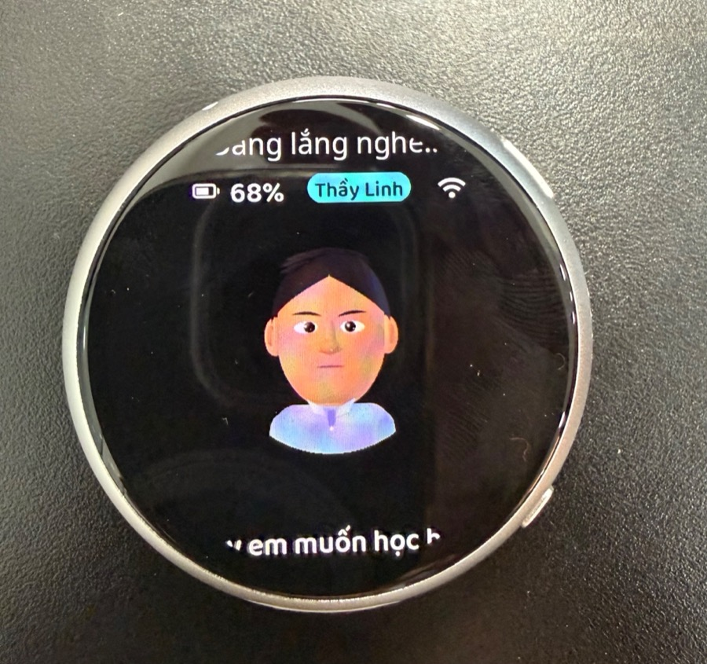
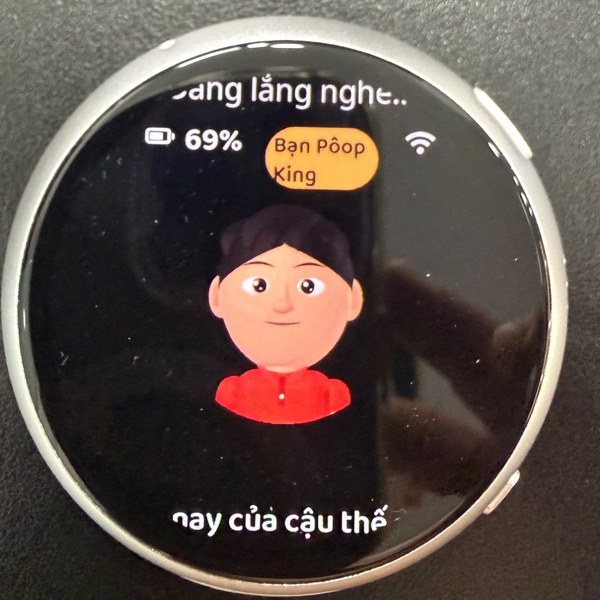
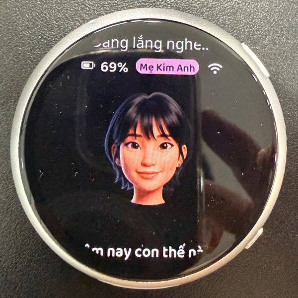
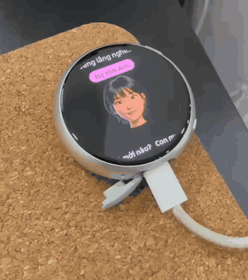

<div align="center">

# 📚 HubStudy

**An AI study companion for Vietnamese primary & secondary students — grounded in the real school curriculum and textbooks.**

[🌐 Live demo](https://study.aicollabx.org) · [📄 Investor brief](INVESTOR_BRIEF.md) · [Roadmap](#roadmap) · [Contact](#contact)

   

</div>

---

## The problem

Vietnamese kids study a dense national curriculum, often alone after school. Generic chatbots drift away from what's in their textbooks, are text-heavy, and are hard for a 6th grader to use without a parent next to them.

## The solution

HubStudy is a voice-first AI tutor that follows **the child's actual school schedule and textbooks**, delivered through three characters:

| Character | Role |
|---|---|
| 🧑‍🤝‍🧑 **Bạn (Buddy)** | Chats when the child is tired; answers curious questions about nature & society |
| 👨‍🏫 **Thầy (Teacher)** | Guides homework and lessons following the school timetable |
| 👩 **Mom** | Listens when the child wants to talk; helps with extra subjects |

A small **ESP32 voice device** lets the child talk to the tutor hands-free and reminds them when it's study time — no screen required.

<p align="center">
  
  
  
</p>
<p align="center"><i>Real ESP32 round-screen prototype (photos, Nov 2026): the three personas (Teacher, Buddy, Mom) listening in Vietnamese.</i></p>

## Demo videos

[](docs/video/demo-personas.mp4)

- [Persona switching, 27 s](docs/video/demo-personas.mp4): the Mom persona greets the student, then the Teacher persona asks what to review today. Real device, real Vietnamese voice, no editing.
- [Teacher tutoring session, 51 s](docs/video/demo-tutor.mp4): the Teacher persona guides a homework question step by step instead of giving the answer.

## Features

- 📖 Curriculum-grounded answers (Vietnamese MOET textbooks)
- 🗓️ Study schedule synced with the school timetable + spoken reminders
- 🎙️ Voice conversation (web, iPad/iPhone, ESP32 device)
- 👪 Parent updates via Zalo *(in progress)*
- 🖥️ Study display dashboard for the home desk

## Architecture

```
 ESP32 voice device ─┐
 iPad / iPhone app ──┼──► Study Hub API ──► LLMs (Gemini Live voice, Claude, GPT) + curriculum knowledge
 Web study display ──┘          │
                                └──► Zalo bridge (parent notifications)
```

Stack: Python · JavaScript · ESP32 firmware · Gemini Live API · Claude API · OpenAI API

## Status

🚧 **Internal pilot (n=1, ~3 weeks)**: in daily use with one 6th-grade student at home. Pre-revenue. Source code is private during the pilot; this repo hosts public docs, roadmap and issue tracking.

## Roadmap

- [x] Voice tutor with 3 characters
- [x] ESP32 voice device prototype
- [ ] Zalo parent delivery (allowlist design done)
- [ ] Full grade 6–9 textbook coverage
- [ ] Multi-family beta (10 families)
- [ ] Teacher/school dashboard

## Contact

Cao Duc Chung — ✉️ hello@aicollabx.org — 🌐 [study.aicollabx.org](https://study.aicollabx.org)
